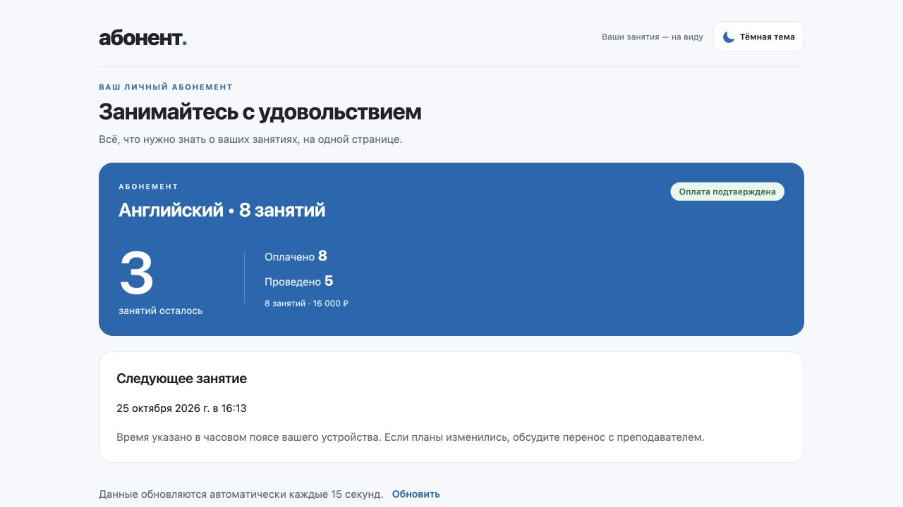

# Абонент

Приложение для репетиторов и других специалистов, которые работают с пакетами занятий. Преподаватель ведёт клиентов, отмечает оплату и занятия. Клиент по личной ссылке видит остаток, историю и следующую встречу без регистрации.



## Возможности

- Клиенты, российские номера телефонов и отдельные пакеты занятий.
- Расписание с календарём, переносы, отмены и исправление отметок о проведении.
- Обзор оплат, стоимости оставшихся занятий и клиентов, которым пора продлить пакет.
- Клиентская ссылка с возможностью отзыва и перевыпуска.
- Светлая и тёмная темы, веб-версия и мобильный клиент Expo.

Получение оплаты преподаватель подтверждает вручную. Остаток рассчитывается на сервере; повторное проведение не списывает занятие второй раз. Деньги через приложение не переводятся.

## Стек

| Часть | Технологии |
| --- | --- |
| Клиент | TypeScript, Expo Router, React Native, React Native Web |
| Формы и данные | React Hook Form, Zod, TanStack Query |
| API | Go, net/http, pgx |
| Хранилище | PostgreSQL 17, миграции goose |
| Развёртывание | Docker Compose, Caddy |

## Запуск

Нужны Docker Engine или Docker Desktop с Compose 2.20+.

```sh
git clone https://github.com/DOPIAS/vtb-abonent.git
cd vtb-abonent
cp .env.example .env
```

В `.env` замените пароль в `POSTGRES_PASSWORD` и `DATABASE_URL`. Затем:

```sh
docker compose config --quiet
docker compose up --build -d
```

Приложение откроется на [localhost:8090](http://localhost:8090). Миграции выполняются перед запуском API. Проверка доступности:

```sh
curl --fail http://localhost:8090/api/v1/health
```

### Демо

Чтобы добавить тестовые данные:

```sh
docker compose --profile demo run --rm seed
```

Вход: `demo@abonent.local` / `DemoPass123!`. В пакете 8 оплаченных занятий, 5 проведённых и 3 оставшихся. Команда выводит клиентскую ссылку.

Повторный запуск сохраняет изменения в демо-пакете и перевыпускает ссылку. Демо предназначено для локального знакомства с приложением.

## Разработка

Для запуска без Docker нужны Node.js 24, Go 1.26+ и PostgreSQL 17+. Порядок настройки API, веб-версии, Expo Go и HTTPS описан в [руководстве по разработке](docs/development.md).

```text
apps/api/           API, авторизация, расчёты и команды миграции
apps/mobile/        Expo-приложение и веб-интерфейс
db/migrations/      схема PostgreSQL
infra/              Dockerfiles и конфигурация Caddy
tests/integration/  HTTP-сценарии на настоящем API
docs/               архитектура и документация
```

[Архитектура](docs/architecture.md) · [Контракт API](docs/contract.md) · [OpenAPI](docs/openapi.yaml)

## Проверки

```sh
make test-api
make test-mobile
make web
```

Для серверных интеграционных тестов задайте `TEST_DATABASE_URL` к отдельной тестовой PostgreSQL. Проверки работающего API запускаются командой `make test-integration`.

[Настройка и состав проверок](docs/testing.md).

## Лицензия

[MIT](LICENSE).
