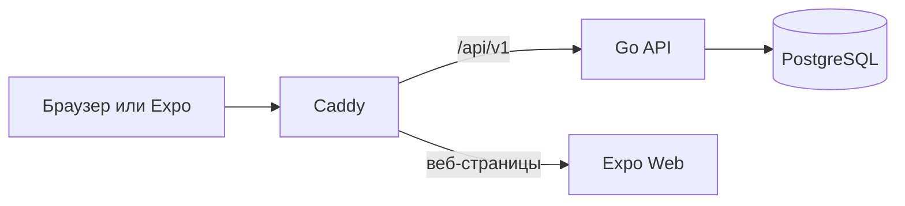

# Архитектура

Один клиент Expo обслуживает кабинет преподавателя и публичную страницу абонемента. Go API отвечает за авторизацию, права доступа и расчёты. PostgreSQL хранит состояние, Caddy обслуживает веб-сборку и проксирует API.



## Модель данных

Преподаватель владеет клиентами. У клиента несколько пакетов, у каждого пакета — занятия и отдельная отзываемая ссылка. Оплата пакета и статус занятия учитываются независимо.

Деньги хранятся в целых копейках, время — как `timestamptz`. API возвращает даты в UTC; интерфейс показывает время устройства. Общее число занятий фиксируется при создании пакета.

## Расчёт остатка

Показатели вычисляются SQL-запросом, отдельного изменяемого счётчика нет:

```text
оплачено = размер пакета, если оплата подтверждена; иначе 0
проведено = число занятий в статусе completed
осталось = оплачено − проведено
```

Оплата и изменения статуса занятия выполняются в транзакции с блокировкой строки пакета. Единый порядок блокировок защищает последний остаток от конкурентного списания. Повторные запросы оплаты и проведения идемпотентны; исправление проведённого занятия требует подтверждения.

Обзор практики читает суммы, очередь продления и расписание из одного repeatable-read snapshot. Продление учитывает общий остаток всех оплаченных пакетов клиента; новый пакет создаётся ожидающим оплаты. Формулы и поля описаны в [контракте](contract.md).

## Доступ

Пароли хешируются Argon2id. Сессия и клиентская ссылка используют независимые случайные токены; PostgreSQL хранит их SHA256-хеши. Каждый защищённый запрос проверяет владельца ресурса.

Сессия преподавателя хранится в `sessionStorage` браузера или SecureStore телефона. Публичная ссылка разрешает только чтение одного пакета и не раскрывает имя, телефон или контакт клиента. Её можно отозвать или перевыпустить. Ответы получают `no-store` и `no-referrer`.

TanStack Query обновляет кабинет после мутаций; публичная страница запрашивает данные каждые 15 секунд и при возвращении фокуса. Выбранная тема хранится отдельно от сессии.

## Развёртывание

Compose запускает PostgreSQL, одноразовые миграции, API и Caddy. Данные сохраняются в томах. Демо-данные создаются только явной командой. Веб-сборка использует один origin для страниц и API, а вложенные маршруты получают SPA fallback.

Основной сценарий не зависит от внешнего банковского API. Подтверждение получения денег выполняет преподаватель. [Разработка и HTTPS](development.md) · [OpenAPI](openapi.yaml).
